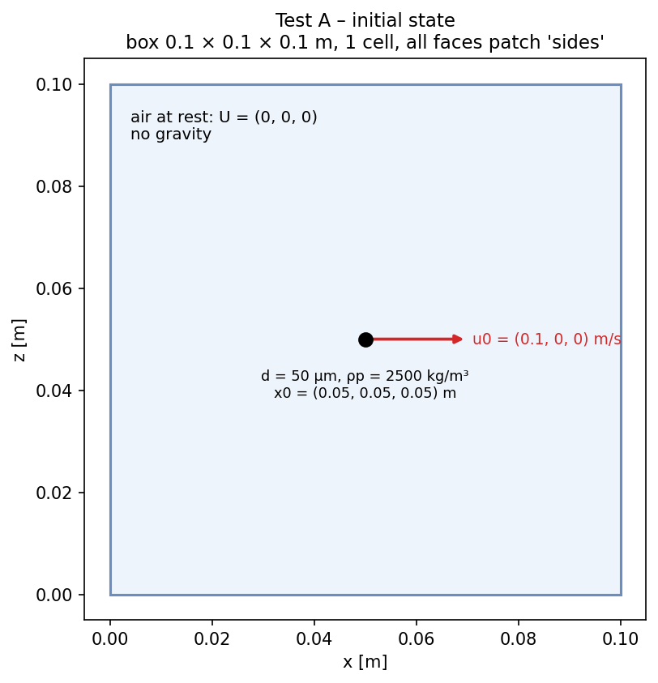

# Test 1 – Integrators (order of accuracy, size of the time step)

**Claim:**
1. the time integrators are correct: Euler is 1st order, RK2 is 2nd order
2. with a big time step Euler still slows the particle down; RK2 speeds it up (wrong) once dt > 2 τp

The integrator only sees `accel(u, x)`, never the forces, so this is proven **once, here**.
The other tests (2, 3) use one scheme at one dt.

**Setup** (reference case in this folder)



- Domain: box 0.1 × 0.1 × 0.1 m, 1 cell, all faces patch `sides` (type `patch`)
- Air at rest: U = (0 0 0), rhoInf = 1.2 kg/m³, nu = 1.5e-5 m²/s (mu = 1.8e-5 Pa·s)
- Particle: solid sphere, d = 50 µm, rho0 = 2500 kg/m³, at (0.05 0.05 0.05) m, U0 = (0.1 0 0) m/s
- Forces: `stokesDrag` only (CdRe = 24), no gravity
- endTime 0.2 s (≈ 10 τp); the particle moves only u0·τp = 1.93 mm

**Reference (exact, Stokes drag)**
- τp = rho0 d² / (18 mu) = 0.01929 s
- u(t) = u0 · exp(−t/τp)
- x(t) = x0 + u0 · τp · (1 − exp(−t/τp))

**Runs** (`scripts/run_A.sh`, NeoFOAM only: OpenFOAM has no `stokesDrag` and no RK2)

| Part | Scheme | dt [s] | Changes to the reference case |
|---|---|---|---|
| 1. order of accuracy | Euler, RK2 | 2e-3, 1e-3, 5e-4, 2.5e-4, 1.25e-4 | `deltaT`, scheme |
| 2. size of the time step | Euler, RK2 | 0.001, 0.02, 0.05 (small, ≈ τp, ≈ 2.6 τp) | `deltaT`, scheme, box 10 m, particle at (5 5 5) |

**Metric**
- part 1: e(dt) = max over t of |u − u_exact| / u0 (and the same for x); p = log2(e(dt) / e(dt/2))
- part 2: does the particle slow down (|u| at t = 0.2 s below u0)?

**Pass**
- part 1: p ≈ 1 (Euler) and p ≈ 2 (RK2) between the two finest dt (±0.1)
- part 2: Euler slows down at every dt; RK2 slows down at the small and medium dt, speeds up at the big dt


**How to run**
```bash
source /usr/lib/openfoam/openfoam2406/etc/bashrc
cd neofoam-lagrangian-validation/frozen_air/01_integrators
scripts/run_A.sh                                     # 16 runs, a few seconds in total
python3 scripts/plot_A.py | tee results/summary.txt  # table + PASS/FAIL, figures/A_*.png
```

**Folders**
- `0.orig/ constant/ system/ Allrun Allclean`: reference case (never run here)
- `runs/`: one copy per run (can be deleted)
- `results/`: the CSV of each run (keep; part 2 in `results/timestep/`), `summary.txt`
- `scripts/`: `run_A.sh`, `plot_A.py`
- `figures/`: `A_setup.png`, `A_velocity.png`, `A_convergence.png`, `A_timestep.png`
