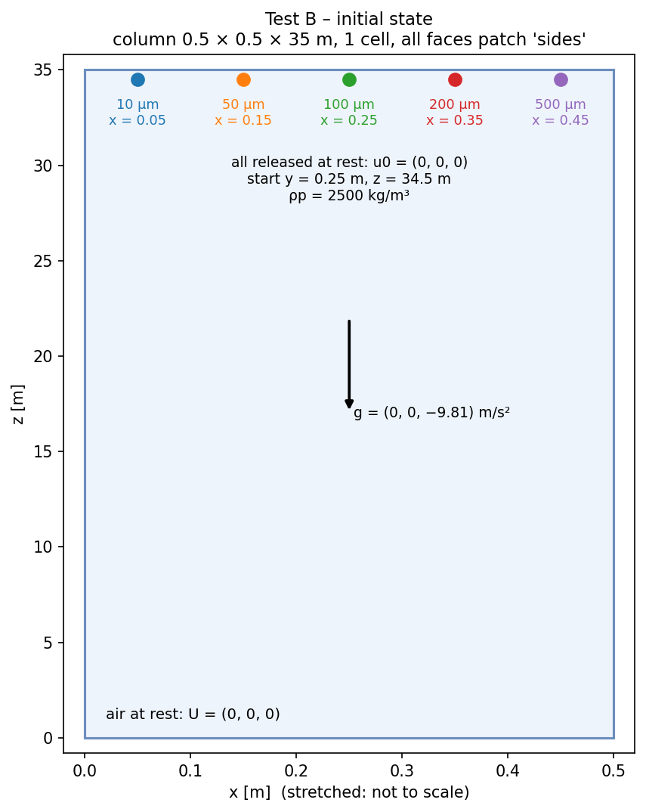

# Test 2 – Forces and drag (settling to terminal velocity)

**Claim:** the forces are correct:
1. gravity + buoyancy, (ρp − ρf)·V·g, together with drag
2. the drag correlations (Putnam `sphereDrag`, `SchillerNaumannDrag`) over Re ≈ 0.005 – 123

**Setup** (reference case in this folder)



- Domain: column 0.5 × 0.5 × 35 m, 1 cell, all faces patch `sides` (type `patch`)
- Air at rest: U = (0 0 0), rhoInf = 1.2 kg/m³, nu = 1.5e-5 m²/s; g = (0 0 −9.81)
- Five solid particles (rho0 = 2500 kg/m³), released at rest at z = 34.5 m, one per injector:

| d [µm] | position [m] | τp [s] | v_t Putnam [m/s] | Re_t |
|---|---|---|---|---|
| 10 | (0.05 0.25 34.5) | 7.7e-4 | 7.53e-3 | 0.005 |
| 50 | (0.15 0.25 34.5) | 1.93e-2 | 0.170 | 0.57 |
| 100 | (0.25 0.25 34.5) | 7.72e-2 | 0.543 | 3.6 |
| 200 | (0.35 0.25 34.5) | 0.309 | 1.39 | 18.6 |
| 500 | (0.45 0.25 34.5) | 1.93 | 3.69 | 123 |

- Forces: drag + `gravity`; dt = 5e-5 s; every run with **RK2 and Euler**

**Runs** (`scripts/run_B.sh`, NeoFOAM only)

6 runs: `<drag>_<scheme>` with `<scheme>` = `RK2`, `Euler` (CSV in `results/<run>.csv`)

| Run | Drag | endTime | Output every | Reference |
|---|---|---|---|---|
| `stokes_RK2`, `stokes_Euler` | `stokesDrag` | 1 s | 0.0005 s | exact: u_z(t) = −v_s (1 − e^(−t/τp)), v_s = τp g (1 − ρf/ρp) |
| `sphere_RK2`, `sphere_Euler` | `sphereDrag` | 8 s | 0.002 s | terminal velocity from the force balance (ρp − ρf) V g = (π/8) μ d CdRe(Re) v_t |
| `SN_RK2`, `SN_Euler` | `SchillerNaumannDrag` | 8 s | 0.002 s | same, with the Schiller–Naumann CdRe |

`stokes` is pure verification (exact solution for every size, even where Stokes drag is
not physical); `sphere` and `SN` test the nonlinear correlations.

**Metric / Pass**
- `stokes`: max over t of |u_z − u_exact| / v_s < 1e-3 (RK2), < 2e-2 (Euler, 1st order) for every diameter
- `sphere`, `SN`: |u_z(t_end) − v_t| / v_t < 1e-4 for every diameter, both integrators

**Figures**
- `figures/B_settling.png`: falling speed over time (sphereDrag, RK2) against the theory; the final speed is written at the end of each line
- `figures/B_terminal.png`: final falling speed of each size, Putnam and Schiller–Naumann (theory, RK2, Euler)
- `figures/B_dragRe.png`: drag compared with Stokes, (Cd Re)/24, against Re: the drag-law curve and the value measured from each NeoFOAM terminal velocity ((Cd Re)/24 = v_Stokes / v_t)

**Result (2026-10-20): PASS.** Stokes error RK2 ≤ 2.6e-4, Euler ≤ 1.1e-2 (both at 10 µm, τp = 7.7e-4 s);
terminal velocities ≤ 3e-13 for both drag laws and both integrators. Full table: `results/summary.txt`.

**How to run**
```bash
source /usr/lib/openfoam/openfoam2406/etc/bashrc
cd neofoam-lagrangian-validation/frozen_air/02_drag_settling
scripts/run_B.sh            # 6 runs; the 8 s runs take 160 000 steps each
python3 scripts/plot_B.py | tee results/summary.txt   # tables + PASS/FAIL, figures/B_settling.png, B_terminal.png
```

**Folders:** reference case (`0.orig/ constant/ system/ Allrun Allclean`), `runs/`, `results/`, `scripts/`, `figures/`
