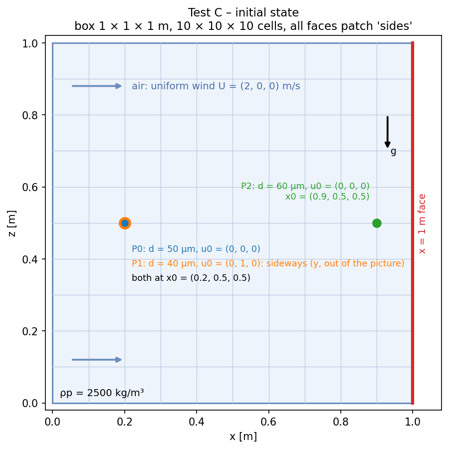

# Test 3 – 3D motion in moving air, crossing cells, leaving the domain

**Claim:**
1. the particle motion is correct in all three components with a moving carrier (uf ≠ 0)
2. locating the particle works when it crosses cells (Q1, Q2)
3. a particle that leaves the domain is deactivated and stops (Q10)

**Setup** (reference case in this folder)



- Domain: box 1 × 1 × 1 m, **10 × 10 × 10 cells** (0.1 m), patch `sides` (type `patch`)
- Air: uniform wind U = (2 0 0) m/s everywhere (fixedValue on `sides`), rhoInf = 1.2, nu = 1.5e-5; g = (0 0 −9.81)
- Three solid particles (rho0 = 2500 kg/m³):

| id | Injector | d [µm] | τp [s] | Start [m] | U0 [m/s] | What it shows |
|---|---|---|---|---|---|---|
| 0 | `particle_d50` | 50 | 0.0193 | (0.2 0.5 0.5) | (0 0 0) | picked up by the wind, crosses 5 cells |
| 1 | `particle_d40` | 40 | 0.0123 | (0.2 0.5 0.5) | (0 1 0) | pushed sideways (+y), the only particle with motion in y |
| 2 | `particle_d60` | 60 | 0.0278 | (0.9 0.5 0.5) | (0 0 0) | leaves through x = 1 m at t ≈ 0.08 s |

- Forces: `stokesDrag` + `gravity` (linear, so exact per component); dt = 5e-4 s, endTime 0.3 s

**Runs** (`scripts/run_C.sh`, NeoFOAM only): 2 runs, `C_RK2` and `C_Euler` (only the integrator changes), CSV in `results/C_<scheme>.csv`

**Reference (exact, per component)**
- u∞ = U_f + τp g (1 − ρf/ρp)
- u(t) = u∞ + (u0 − u∞) e^(−t/τp)
- x(t) = x0 + u∞ t + (u0 − u∞) τp (1 − e^(−t/τp))

**Metric / Pass**
- particles 0, 1: max over t and components of |u − u_exact| / max|u| < 1e-3 (RK2), < 2e-2 (Euler, 1st order)
- particle 2: first output with x ≥ 1 m is 0 – 2 dt after the exact crossing time, the particle
  is frozen afterwards (deactivated), and before leaving the error is below the same limit
- the log reports `particles that left the domain: 1`

**How to run**
```bash
source /usr/lib/openfoam/openfoam2406/etc/bashrc
cd neofoam-lagrangian-validation/frozen_air/03_motion_3d_exit
scripts/run_C.sh            # 2 runs: RK2 and Euler
python3 scripts/plot_C.py | tee results/summary.txt   # results + PASS/FAIL, figures/C_trajectories_RK2.png, C_trajectories_Euler.png
```
Each figure: paths from the side (x–z) and from above (x–y), and the velocity in x, y and z over time
(NeoFOAM line, exact black dashes).

**Result (2026-10-20): PASS.** RK2: velocity error ≤ 1.4e-4, position ≤ 5 µm, P2 leaves in the exact step.
Euler: velocity error ≤ 9.8e-3, position ≤ 2 mm, P2 leaves 1 step late (allowed: 2). Both: P2 frozen after leaving,
log `particles that left the domain: 1`.

**Folders:** reference case (`0.orig/ constant/ system/ Allrun Allclean`), `runs/`, `results/`, `scripts/`, `figures/`
