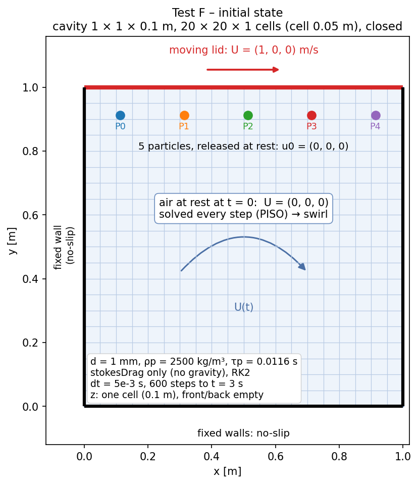

# Test 6 — Live non-uniform air (lid-driven cavity)

**Claim:** the particles are moved by the air **of the current step**, sampled in
the **correct cell**, while the air itself changes in space and in time. The
carrier is the `neoIcoFoam` lid-driven cavity, solved by
`neoIcoKinematicParcelFoam` (PISO + particles, one-way); the particles start at
rest and are carried by the developing swirl.

Unlike [Test 5](../05_uniform_flow/README.md), the air is not uniform and not
steady: `U` changes by ~0.83 m/s over the run, and neighbouring cells differ. Two
classes of bug therefore show up as a trajectory difference:

- **stale air** — the particles are given `U` of an earlier step (or of `t = 0`);
- **wrong cell** — the particles sample a cell other than the one they are in.

**What it does not prove:** that the cavity flow itself is right (that is
`neoIcoFoam`'s job; the tutorial case has the Ghia data), nor anything about
two-way coupling. Test 6 only checks the hand-over of the flow to the particles.
See [Exact solution?](#exact-solution) below.

| setup | result |
|---|---|
|  |  |

## Setup

| | |
|---|---|
| Program | `neoIcoKinematicParcelFoam` |
| Domain | cavity 1 × 1 × 0.1 m, 20 × 20 × 1 cells (cell 0.05 m), closed |
| Boundaries | lid (`movingWall`) `U = (1, 0, 0)` m/s; other walls no-slip; front/back `empty` |
| Fluid | `nu = 0.01 m²/s`, `rhoInf = 1.2 kg/m³` → `mu = 0.012 Pa·s`; Re = 100, laminar |
| Initial air | at rest, `U = (0, 0, 0)` |
| Particles | 5 solid spheres, `d = 1 mm`, `rho0 = 2500 kg/m³`, released at rest near the lid: `x = 0.113, 0.313, 0.513, 0.713, 0.913`, `y = 0.913`, `z = 0.05` m |
| Forces | `stokesDrag` only (no gravity): the particles only follow the air |
| Integration | RK2, `dt = 5e-3 s`, `endTime = 3 s` (600 steps), one particle step per `dt` (`maxCo 1`) |
| Locate | `findCell` (host), `interpolationSchemes/U cell` |
| Output | particle CSV every step; `U` written every step (`writePrecision 16`) |

**Why these numbers**

- `dt / tau_p = 5e-3 / 0.0116 = 0.43` with `tau_p = rho0 d² / (18 mu)`: RK2 is
  stable and accurate (test 1).
- Particle Reynolds number `= rho_f |slip| d / mu < 1.2 · 1 · 1e-3 / 0.012 = 0.1`
  → Stokes drag is the right model, and the replay can use `F = k (u_air - u_p)`
  exactly.
- Courant number `= 1 · 5e-3 / 0.05 = 0.1`.
- Start positions are off the cell faces (cell 0.05), so `floor(x/dx)` is
  unambiguous in the replay.
- **`endTime = 3 s`, not 1 s.** At `t = 1 s` the cavity air is still a thin lid
  boundary layer and the particles only skim the lid (they move 0.14–0.38 m and
  stay within one cell of it). At 3 s they traverse the developing swirl
  (0.29–0.87 m), the frozen-air control grows from 0.38 m to 0.86 m, and the
  paths have a shape worth plotting. Cost: 601 time folders, ~37 MB, ~3 s of
  solver wall time.
- 20 × 20 cells (not the tutorial's 100 × 100) because `U` is written every step.

`constant/g` must exist even without gravity: the program reads it.

## Reference

`scripts/replay_F.py` repeats the particle steps in Python, taking the air of
**each step** from the time folders the solver wrote:

```
step n:  cell = cell of the particle          (arithmetic, uniform 20 x 20 mesh)
         uf   = U(t_n) in that cell           <- the air of THIS step
         one RK2 step, Stokes drag, no gravity
```

The reference is therefore not an analytical solution but the *same arithmetic
on the same air*: if the solver hands over the new `U` every step, the two agree
to round-off. The two **controls** are the same replay with the wrong air, and
they must disagree by a lot — that is what makes the test able to fail:

| Replay uses | Expected | Why |
|---|---|---|
| `U(t_n)` — this step | `< 1e-9 m` | the correct hand-over |
| `U(t_{n-1})` — one step old | `> 1e-6 m` | detects a one-step-stale `U` |
| `U(0) = 0` — start air | `> 1e-6 m` | detects a frozen `U` |

## Metric / pass

`max |x_NeoFOAM - x_Python|` over all particles and steps:

- correct air `< 1e-9 m`;
- both controls `> 1e-6 m`.

## Result

Smoke run `F_smoke`, 2026-10-28, existing `build/production` binary
(built 2026-10-23, i.e. not rebuilt from a clean commit), Serial:

| Replay uses | max \|Δx\| | limit | result |
|---|---|---|---|
| `U(t_n)` — this step | 2.2e-16 m | < 1e-9 m | PASS |
| `U(t_{n-1})` — one step old | 4.0e-3 m | > 1e-6 m | PASS |
| `U(0)` — start air | 8.6e-1 m | > 1e-6 m | PASS |

- air change over the run: `max |U(3) - U(0)| = 8.3e-1 m/s` (the test is not vacuous);
- distance moved per particle: 0.868, 0.564, 0.332, 0.291, 0.485 m; all 5 still in
  the cavity at `t = 3 s`; closest approach to a wall 0.029 m (no wall contact, so
  the replay needs no rebound model).

**This is a smoke run to prove the case construction, not the recorded result.**
The tree had uncommitted changes, and the rule of `RECORD.md` is that every
recorded number points to an exact commit. Rebuild from a clean commit and run
`scripts/run_F.sh` to fill the table in [`../RECORD.md`](../RECORD.md).

## CPU and GPU

The case does not change between executors; only the binary and the executor
flag do.

```bash
source /usr/lib/openfoam/openfoam2406/etc/bashrc
export NEOFOAM_BUILD=<NeoFOAM>/build

# CPU: Kokkos Serial build
NEOFOAM_BIN=$NEOFOAM_BUILD/production/bin scripts/run_F.sh F_cpu

# GPU: CUDA build (needs the coupled solver in the build, see below)
NEOFOAM_BIN=$NEOFOAM_BUILD/production-cuda/bin NEOFOAM_EXECUTOR=GPU \
    scripts/run_F.sh F_gpu

# both, then compare the CSVs
scripts/run_F_executors.sh          # Serial vs GPU
```

`Allrun` passes `-executor $NEOFOAM_EXECUTOR` to the solver; with no override,
`system/controlDict` says `Serial`. Expect the GPU result to agree to round-off
(the two executors do the same float64 arithmetic in a different order): that is
the pass criterion of `run_F_executors.sh` (`max |difference| < 1e-12`).

**Do not expect speed.** With 5 particles there is nothing to parallelise, and
`locateFindCell` copies the particle data and the 400 cell values of `U` to the
host every step. This is the same bottleneck measured in
[`cpu_vs_gpu`](../../frozen_air/cpu_vs_gpu/README.md) (test 2: 1.7 s
CPU vs 21.5 s GPU). Test 6 on the GPU is a *correctness* test, not a performance
test; a speed-up needs many more particles and a device-side locate (`walk`),
which the coupled solver does not support yet.

**Before a GPU run:** the committed CUDA build must contain
`neoIcoKinematicParcelFoam` (it is listed in `examples/CMakeLists.txt`; the
recorded `build/production-cuda` binary from 2026-10-20 predates the coupled
program, so it is missing). Rebuild it:

```bash
source /usr/lib/openfoam/openfoam2406/etc/bashrc
export PATH=/usr/local/cuda/bin:$PATH          # nvcc must be on PATH
cd <NeoFOAM>
NEON_DEVICE=-cuda cmake --preset production
NEON_DEVICE=-cuda cmake --build --preset production -j 8
ls build/production-cuda/bin/neoIcoKinematicParcelFoam
```

`-arch=native` needs a visible GPU at compile time; without one `nvcc` falls back
to a default architecture with a warning, so build on the machine with the card.

## Exact solution?

**For the cavity: no.** The lid-driven cavity has no closed-form solution; the
reference is the Python replay, which reproduces the algorithm, not the truth.
Ghia et al. (1982), shipped as `ghia_u.txt` / `ghia_v.txt` in the tutorial, is a
numerical benchmark for the *flow*, and there is no exact particle path in a
cavity anyway.

Where exact references still apply:

| Case | Exact reference | Status |
|---|---|---|
| 1 (still air, Stokes drag) | `u = u0 e^{-t/tau}`, `x = x0 + u0 tau (1 - e^{-t/tau})` | already used, order 1.00 / 2.01 |
| 2 (terminal velocity) | drag = weight, `u_term` closed form | already used, error ≤ 3e-13 |
| 5 (uniform live flow) | uniform `U` is an exact NS solution; the particle ODE is linear with constant coefficients, so `u(t) = u_inf + (u0 - u_inf) e^{-t/tau}` is exact | **not used**: test 5 compares against test 3. It could be upgraded to an analytical reference |
| 6 (cavity) | none | reproduction test with controls |

If you want an **exact non-uniform, time-varying** field for the live solver, the
cheapest option is a **Taylor–Green vortex**: in 2D,

```
u = A e^{-2 nu k² t} sin(kx) cos(ky),   v = -A e^{-2 nu k² t} cos(kx) sin(ky)
```

is an exact solution of the incompressible NS equations, and with `k = 2π/L` it
satisfies `symmetry` boundary conditions on all four sides (normal velocity zero,
zero normal gradient of the tangential velocity) — the same patch type test 5
already uses. That gives an exact `U(x, t)` to compare the solved field against
*and* an exact field for a high-accuracy particle reference (RK4 on the analytical
`U`), so the comparison becomes a **convergence test** (`Δ → 0` as the mesh and
`dt` are refined) instead of a round-off test.

That is a different claim from test 6 and would be a new test (call it test 7): test 6 proves
"the solver hands over the live air and locates the cell correctly"; H would
prove "the coupled solution converges to the exact one".

## How to run

```bash
source /usr/lib/openfoam/openfoam2406/etc/bashrc
cd neofoam-lagrangian-validation/solved_air/06_cavity
scripts/run_F.sh                 # default run name: 06_cavity
# or: scripts/run_F.sh F_rerun
```

`run_F.sh` copies the clean case to `runs/<name>/`, runs `blockMesh` and the
solver, copies the particle CSV to `results/<name>.csv`, and runs
`scripts/replay_F.py`, saving its table to `results/<name>.summary.txt`.

Unlike test 5, `Allrun` **keeps the time folders**: the replay reads
`0.005/U … 3/U`. They stay inside the gitignored `runs/<name>/` (~37 MB).

Figures: `python3 scripts/plot_F.py runs/<name>` (needs the time folders) writes
`figures/F_particles.png`; `python3 ../draw_setups.py` redraws all setup
schematics of this suite.

## Layout

```
06_cavity/
├── README.md
├── 0.orig/ constant/ system/     clean case (no mesh, no time folders)
├── Allrun Allclean
├── scripts/run_F.sh              case -> runs/<name>, run, collect CSV
├── scripts/replay_F.py           replay + 2 controls, PASS/FAIL
├── scripts/plot_F.py             paths + controls -> figures/F_particles.png
├── scripts/run_F_executors.sh    Serial vs GPU, compare the CSVs
├── figures/F_setup.png           setup schematic (../draw_setups.py)
├── figures/F_particles.png       result figure (plot_F.py)
├── results/                      filled by run_F.sh (gitignored)
└── runs/<name>/                  run + time folders + CSV + log (gitignored)
```

## Notes

- **Why a cavity and not Couette/Poiseuille?** A steady analytical shear profile
  would make `U(t_n) = U(t_{n-1})`, so the "one step old" control could not
  detect a stale hand-over. A start-from-rest cavity changes every step.
- **`locate walk` is rejected** in the coupled program: its `CarrierField` is
  built once from the start `U`, so walk could not see the flow change.
  `createParticles.H` exits with a `FatalError` if walk is selected.
- **`coupled false`** in `kinematicCloudProperties` is an OpenFOAM keyword that
  the NeoFOAM reader ignores; one-way behaviour is enforced by the code.
- **Wall rebound** (`standardWallInteraction`) is configured but never reached:
  the closest approach is 0.029 m. The replay does not model rebound, and
  `replay_F.py` prints a warning if a particle ever leaves the domain.
